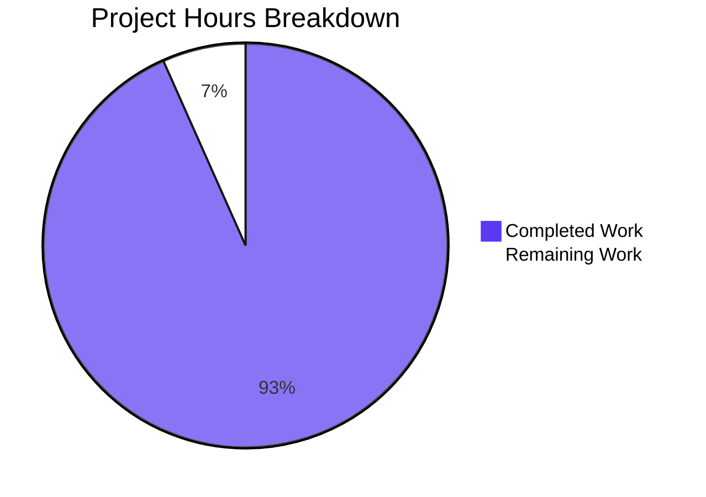

# 1. Executive Summary

## 1.1 Project Overview

A single-file, zero-dependency Node.js console program whose entire observable behaviour is printing `Welcome to Blitzy` to standard output, unformatted, together with a three-line install and run note. It targets a developer or reviewer who runs one command and reads one line — the canonical check that the runtime is wired up end to end. The whole deliverable is two files at the repository root: `index.js`, which is two lines (one JSDoc summary and one `console.log` statement), and `README.md`. There is no dependency, manifest, lockfile, configuration, build step, service, data store or user interface, so the maintenance surface is exactly those two files.

## 1.2 Completion Status

Total project hours are 15.0: **14.0 complete, 1.0 remaining — 14.0 ÷ 15.0 = 93% complete.**


| Metric | Hours |
|---|---|
| Total Hours | 15.0 |
| Completed Hours (AI + Manual) | 14.0 |
| Remaining Hours | 1.0 |

## 1.3 Key Accomplishments

- [x] Prints exactly `Welcome to Blitzy`, unformatted, on stdout.
- [x] A two-line source: one JSDoc summary line, one `console.log` statement.
- [x] Runs with `node index.js` from the repository root — nothing to install, build or configure.
- [x] Byte-stable output: the same 18 bytes on every run, including 20 concurrent invocations.
- [x] Zero dependencies: no manifest, lockfile or `node_modules`.
- [x] No side effects: a run creates, modifies and deletes nothing.
- [x] A three-line install/run note whose three claims all check out against the tree and the runtime.
- [x] A closed two-file deliverable set: no test, config, CI, container, licence, changelog or badge path.

## 1.4 Critical Unresolved Issues

Six of the fifteen AAP-scoped items carry something open: two need human action before release, and four are accepted behaviours with no settlement the constraints permit. No scoped requirement is unimplemented.

| Issue | Impact | Owner | ETA |
|---|---|---|---|
| The deployment host's runtime is unverified; the note's version claim is tied to v22.23.3 and nothing in the repository pins a version | The note can read stale on a differently-versioned host | Project owner | Before release — 0.5h |
| The project's change record is not reconciled with the delivered change set: the README path was delivered by replacing the scaffold in place, recorded as a new file | A reader reconciling the record against the change set can misread the modification as out of scope | Project owner | Before release — 0.5h |
| Accepted, no permitted fix (4): silent success when stdout is unwritable or closed; host-level process steering can abort the run before the program executes; the note's run command resolves only from the repository root; `npm test` and `npm run build` are unavailable because there is deliberately no manifest | A consumer can see success without the message; a Node-level boot failure can be mistaken for a program failure; the documented command fails outside the repository root; conventional package commands error out | Accepted by the project owner | No action — every settlement is excluded by the delivery constraints |

## 1.5 Access Issues

No access issues identified: the program needs no credential, secret, service, network access, port or environment variable, and no repository permission beyond the checkout itself.

## 1.6 Recommended Next Steps

1. [High] Run `node index.js` on the deployment host's runtime; refresh `README.md` line 3 if its version differs (0.5h).
2. [Medium] Reconcile the project's change record with the delivered change set (0.5h).
3. [Medium] Capture release evidence from a clean checkout: the 18-byte sequence, empty stderr, exit 0.
4. [Low] Treat any change to the message, file set or run command as a new scope decision.
5. [Low] Leave the absent test suite, manifest, lint/CI gate and error handling absent; do not add a manifest to silence `npm test`'s `ENOENT`.

# 2. Project Hours Breakdown

## 2.1 Completed Work Detail

| Component | Hours | Description |
|---|---|---|
| Console program — message and output contract (`index.js`) | 5.0 | The two-line source: the exact `Welcome to Blitzy` literal, printed unformatted by a single `console.log`, under one untagged JSDoc summary line. Covers the byte-exact verification of the 18-byte output contract across repeated, concurrent, alternate-consumer and clean-environment runs, and confirmation that nothing reaches stderr (F1, F2, N3, N4 of the AAP). |
| Zero-dependency, configuration-free runtime posture | 2.0 | No manifest, lockfile, dependency, configuration file or environment-variable read, and no build step. Verified to run with an empty environment, without a PATH-resolved helper, without network access and without filesystem, child-process or worker permissions (N1, N2). |
| Install and run note (`README.md`) | 2.0 | Three lines — heading, blank line, note — under the five-line cap and free of every excluded section; its runtime, no-install and run-command claims each checked against the tree and the live runtime (N5 and the note's claim accuracy). |
| Closed two-file deliverable set, placement and scope exclusions | 2.0 | Both files at the repository root and runnable by a bare `node index.js` with no manifest script entry; every excluded path — manifest, lockfile, test, CI/CD, container, configuration, docs folder, licence, changelog, badge and diagram — confirmed absent; smallest-possible change with no refactoring, reformatting or renaming. |
| Whole-tree acceptance and static verification | 3.0 | Byte-identity of both files to the specified contents, the syntax gate (`node --check` exit 0), stub/marker and secret sweeps at zero, and the acceptance pass over every requirement in the AAP's inventory. |
| **Total** | **14.0** | |

## 2.2 Remaining Work Detail

| Category | Hours | Priority |
|---|---|---|
| Deployment-host runtime confirmation and version-note refresh — run the program on the target host's runtime and update `README.md` line 3 if the host's version differs from v22.23.3 (path to production: the note's runtime claim is an environment fact, and no version is pinned) | 0.5 | Medium |
| Change record reconciliation — note that the README path was delivered by replacing the existing two-line scaffold in place, so the change set and the project's record agree | 0.5 | Low |
| **Total** | **1.0** | |

Section 2.1 (14.0 hours) plus Section 2.2 (1.0 hour) equals the 15.0 total hours in Section 1.2, and the 1.0 remaining hour is the same figure carried in Sections 1.2, 1.4 and 7. Everything else a reader might expect — a test suite, a coverage target, a lint or CI gate, a dependency manifest, a runtime pin, write-error handling — is excluded by the request's own constraints, so it is an accepted absence rather than remaining work and carries no hours.

# 3. Test Results

| Area / Category | Framework | Tests | Passed | Failed | Coverage | What This Proves |
|---|---|---|---|---|---|---|
| Whole-package gate | Node built-in test runner (`node --test`) | 0 | 0 | 0 | None configured | The repository executes cleanly under the platform's whole-package runner and ships no test artefact, which is what its constraints require. |
| Output contract — message and bytes | `node index.js` with `od -c`, `wc -c`, `sha256sum`, shell string equality | 3 | 3 | 0 | n/a | Stdout is exactly `Welcome to Blitzy` followed by one newline — 18 bytes, `57 65 6c 63 6f 6d 65 20 74 6f 20 42 6c 69 74 7a 79 0a` — with nothing on stderr and exit status 0. |
| Determinism across repeated and concurrent runs | 20 sequential invocations plus 20 simultaneous ones, output lines sorted and compared | 40 | 40 | 0 | n/a | Every run emits one identical byte sequence: 1 distinct output line, 0 bytes of stderr, all exit 0, no shared state or lock contention. |
| Syntax / static gate | `node --check index.js` | 1 | 1 | 0 | n/a | The delivered source parses with no diagnostics. |
| Clean-environment and isolation runs | `env -i`, PATH-less invocation, `unshare -rn`, argument and stdin matrix | 4 | 4 | 0 | n/a | The program needs no environment, no PATH-resolved helper, no network access and no input; extra arguments (`--help`, positional), piped or closed stdin and an absolute-path invocation all yield the same bytes. |
| Module interface | `require()` export probe | 1 | 1 | 0 | n/a | Loading the file prints its message and exports no keys — nothing callable, no usage text, no argument handling. |
| Deliverable set, exclusions and side effects | Tree listing, absent-path sweep, `git status`, file digests | 3 | 3 | 0 | n/a | Exactly two delivered paths exist, every excluded path is absent, and runs leave the working tree, both file digests and the git status unchanged. |
| **Total** | — | **52** | **52** | **0** | — | The delivered behaviour is byte-exact, deterministic, dependency-free and side-effect-free. |

**Not Covered**

- No automated test suite exists and none is permitted by the delivery constraints, so no case is protected by a harness and no coverage metric exists; `node --test` reports 0 tests with exit 0. Before release, run the byte-exact commands in Section 9 — they are the whole correctness gate this repository supports.
- The two-line source shape, the one-line JSDoc form, and the note's line count and absent sections are static properties, not observable by running the program; they were confirmed by reading the files rather than by a test.
- No lint, format, type-check or security-scanner gate exists, and none can be added without a file or dependency the constraints exclude.
- No browser-rendered surface exists — no page, DOM, client console or network request — so no UI, responsive, accessibility or cross-layer check applies.
- The deployment host's Node runtime was not exercised: the program was run on v22.23.3, and the note's version claim remains an environment fact (carried in Section 2.2).
- A terminal-attached (pseudo-terminal) capture was not exercised: a consumer that captures through a terminal sees a carriage return inserted by the terminal's own newline translation, which is not program output. Assert the contract on a piped or redirected capture.

# 4. Runtime Validation & UI Verification

- ✅ **Startup and primary flow** — `node index.js` from the repository root prints `Welcome to Blitzy` and exits 0 with nothing on stderr.
- ✅ **Output contract** — stdout is exactly 18 bytes with one trailing newline; no colour, escape sequence, label, prefix, banner or border.
- ✅ **Determinism and concurrency** — 20 simultaneous invocations produced one identical output; repeated sequential runs were byte-identical.
- ✅ **Clean environment** — a run with an empty environment (`env -i`) and a run with no `PATH` produced the same bytes.
- ✅ **No network resource** — a run inside an isolated network namespace produced the same bytes.
- ✅ **Invocation interface** — extra arguments, `--help` and piped or closed stdin changed nothing: same bytes, no usage text, no blocking on input.
- ✅ **Module interface** — loading the file with `require()` printed the message and returned no exported keys.
- ✅ **No side effects** — after runs, the working tree, both file digests and the git status were unchanged.
- ✅ **Deliverable set** — exactly two paths exist; no manifest, lockfile, test, configuration, CI or container file is present.
- ✅ **Syntax gate** — `node --check index.js` exited 0 with no diagnostics.

**Never exercised at runtime.** There is no user interface, page, DOM, client console or network request, so no screen, browser flow or responsive, accessibility or cross-layer check was driven and no screenshot or screen recording exists. No HTTP, API, database, message-broker, file-system or third-party integration was exercised because the program has none — stdout is its only integration point. The deployment host's runtime was not exercised (the program ran on v22.23.3), and a terminal-attached capture was not exercised, so a consumer reading the contract through a terminal must allow for the carriage return its line discipline inserts. No failure or unwritable-output path was exercised as a pass: a run reports success without the message when the consumer closes or cannot accept stdout, which is carried in Section 1.4.

# 5. Compliance & Quality Review

## 5.1 Compliance Matrix

| # | Deliverable / Benchmark | Status | Evidence |
|---|---|---|---|
| 1 | Exact message printed — `Welcome to Blitzy`, capital `W` and `B`, single spaces, no trailing punctuation | ✅ PASS | `index.js:2`; observed stdout 18 bytes `57 65 6c 63 6f 6d 65 20 74 6f 20 42 6c 69 74 7a 79 0a`; string-equality check passes |
| 2 | Output unformatted — no colour, banner, label, prefix, border or surrounding text | ✅ PASS | One `console.log` of one string literal; no escape byte in the captured stream; no template, concatenation or alternate output call |
| 3 | Fewest lines and tokens — two-line source | ✅ PASS | 2 lines, 79 bytes, 1 executable statement; no shebang, blank line or helper |
| 4 | One-line JSDoc summary, untagged, and the only comment in the tree | ✅ PASS | `index.js:1`; one `/**` and one `*/` on that line; no `@param`, `@returns` or example |
| 5 | Zero dependencies and zero install steps | ✅ PASS | No manifest, lockfile or `node_modules`; 0 imports; runs with nothing installed |
| 6 | No configuration, environment variables or build step | ✅ PASS | 0 environment reads; no `.env` or config file; no build output; identical output with an empty environment |
| 7 | No error handling or logging beyond the single print | ✅ PASS | 0 error-handling constructs; one statement; stderr measured 0 bytes on every run |
| 8 | Deterministic, byte-stable output | ✅ PASS | 20 sequential runs collapse to 1 distinct line; 20 simultaneous runs to 1 distinct output |
| 9 | Install and run note within five lines, free of excluded sections | ✅ PASS | `README.md` 3 lines; 0 matches for contributing, licence, testing, deployment, architecture or table-of-contents |
| 10 | Closed file set — no path beyond the two deliverables, every excluded path absent | ✅ PASS | Tree holds exactly `README.md` and `index.js`; manifest, lockfile, test, CI/CD, container, configuration, docs, licence, changelog, badge and diagram paths all absent |
| 11 | Smallest possible change — no unrelated refactoring, reformatting or renaming | ✅ PASS | 5 insertions, 2 deletions, 2 files; no path deletion, no rename; the only deletions are the scaffold lines the specified note replaces |
| 12 | Security posture — no secret, no input path, no injection sink, no third-party code | ✅ PASS | 0 matches for credential-shaped literals, environment/argv/stdin reads and `eval`/`Function`/child-process/file/network sinks; files are mode 644 |

A test suite and a coverage target are not applicable here: they are excluded by the request's constraints, so their absence is compliance rather than a gap, and the position is recorded in Section 3.

## 5.2 AAP & Rule Divergences and Gaps

| What the AAP/Rule Required | What Was Delivered Instead | Why It Diverged | Impact | Remediation |
|---|---|---|---|---|
| Both deliverable rows recorded as new files, with the change stated as touching no existing file | `README.md` was replaced in place — the change set records `M README.md` — with content exactly as specified (commit `1143607`) | The checkout already held a two-line scaffold README, so the specified final content could only be reached by replacing it | None to the delivered content; a reader reconciling the record against the change set can misread the modification as out of scope | Record the operation as an in-place replacement (0.5h, Section 2.2) |
| Ship the standing defaults: a test suite, a coverage target, a static/lint or CI gate, a dependency manifest or lockfile, a pinned runtime, and defensive error handling | None of them: no test path, no manifest or lockfile, no lint/CI configuration, no runtime pin, no error handling (`node --test` reports 0 tests; `npm test`/`npm run build` exit 254 with `ENOENT`) | Sanctioned by the user's own constraint inventory — no test suite, test files, lockfile or dependency, and no 404 handler, error handler, environment-variable configuration or unrequested hardening — which is recorded as outranking those defaults | No automated regression guard protects the two-line program; the runtime is unpinned; conventional package entry points are unavailable | None required: accepted; a suite may be added only if the constraint is lifted |
| No requirement covers a failed write; no error handling is permitted | A run exits 0 with empty stderr when stdout is unwritable or closed, so the message is silently not delivered | The failed write is swallowed by Node's `console.log`, and the only settlement is error handling the constraints exclude | A downstream consumer can record success although nothing was printed | None available within the constraints; assert the captured bytes |

**Row 1.** The repository was not empty when the work started: the baseline commit held a two-line platform scaffold (`# abk-6296-testing-4f1b7457`, `Created by Blitzy`), so `README.md` was delivered by replacing it in place rather than by adding a new file (`git diff --name-status` → `M README.md`, `A index.js`). The delivered three lines are character-for-character the specified content, so nothing the reader relies on differs. What did not follow is the record, which still describes both paths as new. Close it by recording the operation as an in-place replacement, so a future reader comparing the record with the change set does not have to decide whether the modification was in scope.

**Row 2 (Sanctioned).** The standing defaults for a delivered repository — a test suite, a coverage target, a static or CI gate, a dependency manifest, a pinned runtime, and defensive error handling — were deliberately not shipped. The user's own constraint inventory forbids each of them ("Do not add a test suite, test files, a lockfile, or any dependency"; "Do not add a 404 handler, error handler, environment-variable configuration, or any hardening not explicitly requested"), and the user's constraints outrank those defaults. The consequence is accepted: nothing fails if a future edit changes the message, and `npm test` errors with `ENOENT`. Treat the byte-exact run in Section 9 as the regression gate, and do not add a manifest to silence it.

**Row 3.** When a consumer closes stdout, or stdout points at a target that rejects the write, the process exits 0 with nothing on stderr, so a wrapper cannot tell a delivered message from a failed write. That is Node's `console.log` behaviour rather than anything the two-line program does, and the only settlement — a write-error path — is error handling the constraints exclude. A caller that must know the message arrived should assert the captured bytes rather than the exit status. Nothing here needs a code change.

No other divergence from the AAP or the user's rules was identified. The two nuances a reader should nonetheless know — the note's run command resolves only from the repository root, and the process can be steered from outside the program before it runs — are behaviours the constraints mandate rather than departures from them, and both are carried in Sections 1.4 and 6.

# 6. Risk Assessment

| Risk | Category | Severity | Probability | Mitigation | Status |
|---|---|---|---|---|---|
| No automated regression guard: an edit to the message, the file set or the run command changes behaviour with nothing to catch it | Technical | Medium | High | Keep the byte-exact `node index.js` check as the release gate; a test suite may be added only if the constraint is lifted | Accepted — mandated by the delivery constraints |
| No lint, format, type-check, coverage or security-scanner gate exists, and none can be added without an excluded file or dependency | Technical | Low | High | `node --check index.js` plus a two-line review surface | Accepted — mandated |
| Runtime drift: the note's version claim is tied to v22.23.3 and nothing in the repository pins a version | Operational | Low–Medium | Medium | Confirm the program on the deployment host's runtime and refresh `README.md` line 3 if it differs | Open — 0.5h (Section 2.2) |
| A run reports success without printing when stdout is unwritable or closed | Operational | Low–Medium | Low | Consumers assert the captured bytes rather than the exit status | Accepted — every settlement is excluded |
| Conventional package entry points are unavailable: `npm test` and `npm run build` exit 254 with `ENOENT` because there is deliberately no manifest | Operational | Low | High | Use the documented run command; do not add a manifest to silence it | Accepted — by design |
| The process can be steered from outside the program before it runs (`NODE_OPTIONS`, `--inspect`), and no defensive handling is permitted | Security | Low | Low | Treat a pre-run boot failure as an environmental fault rather than a program fault | Accepted — mandated |
| The note's run command is relative, so it fails when invoked outside the repository root | Operational | Low | Medium | Run from the repository root or invoke the file by absolute path | Accepted — the note's text is fixed |
| The project's change record is not reconciled with the delivered change set (the README path was replaced in place, recorded as a new file) | Delivery | Low | Medium | Record the in-place replacement so the record and the change set agree | Open — 0.5h (Section 2.2) |

No integration risk exists: stdout is the program's only integration point. It opens no socket, binds no port, calls no service, reads no input and requires no credential, so there is no untested external integration, missing key or network dependency to fail.

# 7. Visual Project Status

Colour key: **Completed = Dark Blue (`#5B39F3`)**, **Remaining = White (`#FFFFFF`)**.



**Remaining work by category (1.0 hour total, matching Sections 1.2 and 2.2):**

| Category | Hours | Priority |
|---|---|---|
| Deployment-host runtime confirmation and version-note refresh | 0.5 | Medium |
| Change record reconciliation | 0.5 | Low |

**Priority distribution:**

| Priority | Hours | Share of remaining |
|---|---|---|
| High | 0.0 | 0% |
| Medium | 0.5 | 50% |
| Low | 0.5 | 50% |

**Delivery status at a glance:** 15 of 15 AAP-scoped items are implemented as written; 14.0 of the 15.0 project hours are complete (93%); 6 items carry something still open — 2 needing human action and 4 accepted with no settlement the constraints permit — and none of them is an unimplemented requirement.

# 8. Summary & Recommendations

**What was delivered and verified.** The repository now contains exactly two deliverables at its root: `index.js`, a two-line program that prints `Welcome to Blitzy` unformatted, and `README.md`, a three-line install and run note stating that nothing needs installing and giving the command that runs the program. Verification was behavioural rather than merely structural: the program was run repeatedly, 20 processes at a time, with an empty environment, without a PATH-resolved helper, inside an isolated network namespace, with extra arguments and with piped or closed stdin. In every case it produced the same 18 bytes on stdout, nothing on stderr and an exit status of 0, and it left the working tree, both file digests and the git status unchanged.

**Where the project stands.** All fifteen AAP-scoped items are implemented as written, and 14.0 of the 15.0 project hours are complete — 93% (14.0 ÷ 15.0). The one remaining hour is release hygiene rather than missing capability: confirming the program on the deployment host's Node runtime and refreshing the note's version claim if the host differs (0.5h), and recording that the README path was delivered by replacing the existing two-line scaffold in place (0.5h). Six items carry something still open: those two, plus four accepted behaviours — silent success when stdout is unwritable or closed, exposure to host-level process steering before the program runs, a run command that resolves only from the repository root, and conventional `npm` entry points that error because there is deliberately no manifest.

**Critical path to production.** Run `node index.js` on the target runtime; capture `node index.js | od -c` from a clean checkout and confirm the 18-byte sequence, empty stderr and exit 0; reconcile the change-operation record; then deploy exactly as the note describes — copy the file and run it with Node.js. No build, packaging, configuration or migration step exists to schedule around, and no service has to be started or stopped.

**Success metrics.** The contract is a byte sequence, so success is unambiguous: stdout `Welcome to Blitzy` plus one newline (18 bytes, `57 65 6c 63 6f 6d 65 20 74 6f 20 42 6c 69 74 7a 79 0a`), stderr empty, exit status 0, and one identical output across repeated and concurrent runs. Alongside it: zero dependencies, zero configuration, no ports bound, no side effects, and a tree that holds only the two delivered files.

**Production readiness.** Ready for its stated purpose — a single-file, zero-dependency console program that prints one unformatted line — with the residual risk concentrated in what the constraints deliberately leave out: no automated regression guard, no lint or static gate, no runtime pin. Those are accepted absences, not defects, and they must not be "fixed" by adding a manifest, a test suite or error handling; the byte-exact run in Section 9 is the release gate that stands in their place.

# 9. Development Guide

## System Prerequisites

- **Node.js 22** — verified on **v22.23.3**, resolved as `node` on `PATH`.
- **npm is not needed** and no package manager step exists.
- No database, message broker, cache, web server, container runtime, port, credential, secret or environment variable is required anywhere in this project.
- No operating-system-specific dependency exists: the program touches no file, socket, path or locale.

```bash
node --version        # v22.23.3
command -v node       # the node binary the run command will use
```

## Environment Setup

There is nothing to set up. The repository has no `.env` file, no configuration file and no build step, and the program reads nothing from the environment. Run every command from the repository root.

## Dependency Installation

Nothing is installed, and nothing needs to be: the only call in the program is Node's built-in `console.log`.

Do **not** run `npm install` and do **not** create a `package.json` or a lockfile: the delivery constraints close the file set at `index.js` and `README.md`, and the conventional package entry points fail with `ENOENT` precisely because no manifest exists.

## Application Startup

One step, with no service, port or background process:

```bash
cd <repository root>
node index.js
```

Expected output — exactly this single line, to stdout:

```
Welcome to Blitzy
```

## Verification Steps

```bash
node index.js
    # the documented run command produces the documented line

node index.js | od -c
    # byte-exact contract: 18 bytes, one trailing newline, no escape sequence

node index.js | wc -c
node index.js 2>&1 >/dev/null | wc -c
node index.js >/dev/null; echo $?
    # 18 bytes out, 0 bytes on stderr, exit 0

[ "$(node index.js)" = "Welcome to Blitzy" ] && echo PASS
    # string equality

for i in $(seq 1 20); do node index.js; done | sort -u | wc -l
    # determinism across repeated runs

node --check index.js; echo $?
    # syntax gate: the only static gate the repository supports

node --test
    # whole-package gate: exits 0 and reports 0 tests, by design

sha256sum index.js README.md
    # integrity of the two delivered files

node -e "console.log(JSON.stringify(Object.keys(require('./index.js'))))"
    # nothing is exported and no arguments are read
```

Expected results: `18`, `0`, `0`, `PASS`, `1`, `0`, a 0-test result from the whole-package gate, the two digests `2820a73c997882c312a2f81a9a7a5f27bc82f4d13a7ef5318bb58e8dd3dade1e` for `index.js` and `433b3f14cb8d7bfb1786ec3e211e9401a2438931d41d2329b0811a2d301997c0` for `README.md`, and a message line followed by `[]`.

## Example Usage

```bash
node index.js
    # run it and read the line

node index.js | grep -qx 'Welcome to Blitzy' && echo "contract holds"
    # assert the exact message in a pipeline

env -i "$(command -v node)" index.js
    # prove it needs no environment and no helper on PATH
```

## Troubleshooting

| Symptom | Cause | Resolution |
|---|---|---|
| `npm error code ENOENT` from `npm test` or `npm run build` (exit 254) | There is deliberately no `package.json` | Expected. Run `node index.js`; do not add a manifest. |
| `Cannot find module` naming `index.js` | The command was run outside the repository root, and the note's command is relative | `cd` to the repository root, or invoke the file by absolute path. |
| The captured output ends with a carriage return (`0d 0a`) instead of a newline | The capture went through a terminal, whose line discipline translates the newline | Capture through a pipe or a file instead: `node index.js \| od -c`. |
| The command reports success but nothing appears | The consumer closed stdout or stdout cannot accept the write; the exit status stays 0 | Assert the captured bytes rather than the exit status, and check the consumer's own plumbing. |
| The process aborts before printing anything (`node:internal` errors, `--inspect` messages) | The host steered Node itself, for example `NODE_OPTIONS=--require <missing>` | Treat it as an environment fault, not a program fault; clear `NODE_OPTIONS` and re-run. |
| `eslint`, `tsc`, coverage or scanner commands are not found | No lint, type-check or coverage tooling is installed, and it may not be added | Use `node --check index.js` and the byte-exact run as the static and behavioural gates. |

# 10. Appendices

## Appendix A: Command Reference

| Command | Purpose | Expected result |
|---|---|---|
| `node index.js` | Run the program from the repository root | Prints `Welcome to Blitzy`; exit 0 |
| `node index.js \| od -c` | Inspect the exact output bytes | 18 bytes ending `y \n` |
| `node index.js \| wc -c` | Count stdout bytes | `18` |
| `node index.js 2>&1 >/dev/null \| wc -c` | Count stderr bytes | `0` |
| `[ "$(node index.js)" = "Welcome to Blitzy" ] && echo PASS` | Assert the message | `PASS` |
| `for i in $(seq 1 20); do node index.js; done \| sort -u \| wc -l` | Check determinism across runs | `1` |
| `node --check index.js` | Syntax gate | exit 0, no diagnostics |
| `node --test` | Whole-package gate | exit 0, `# tests 0` |
| `node -e "Object.keys(require('./index.js'))"` | Confirm nothing is exported | prints the line, then `[]` |
| `env -i "$(command -v node)" index.js` | Run with no environment | Prints `Welcome to Blitzy` |
| `sha256sum index.js README.md` | Verify file integrity | `2820a73c…` and `433b3f14…` |
| `git diff --numstat 584280a..HEAD` | Review the delivered change | `3 2 README.md`, `2 0 index.js` |

## Appendix B: Port Reference

None. The program binds no port, opens no socket and accepts no connection; it writes to stdout and exits. Nothing in the repository configures a port.

## Appendix C: Key File Locations

| Path | Role |
|---|---|
| `index.js` | The whole program: one JSDoc summary line and one `console.log` statement (79 bytes, 2 lines) |
| `README.md` | The only documentation: heading, blank line, and the install/run note (105 bytes, 3 lines) |

No other path is part of the deliverable. Directories used only for local browser artefacts, if present in a working copy, are empty and carry no project content.

## Appendix D: Technology Versions

| Component | Version | Notes |
|---|---|---|
| Node.js | v22.23.3 (verified) | Resolved as `node` on `PATH`; the supported floors are 22.12.0 for the 22.x line and 20.20.2 for 20.x |
| npm | 11.x | Present on the host but unused; no manifest exists |
| Program dependencies | None | The only call is the built-in `console.log` |
| Runtime pin | None | Pinning would require a manifest, which the constraints exclude |

## Appendix E: Environment Variable Reference

| Variable | Required | Effect |
|---|---|---|
| — none — | No | The program reads no environment variable; a run with an empty environment produces identical output |
| `NODE_OPTIONS` | No | Host-level only. Setting it can alter or abort the process before the program runs; leave it unset for a clean run |

## Appendix F: Developer Tools Guide

- **Run and inspect:** `node index.js`, `node index.js | od -c`, `node index.js | wc -c`.
- **Static gate:** `node --check index.js` — the only static check available; no lint, format or type-check tooling is installed and none may be added.
- **Whole-package gate:** `node --test` — exits 0 and returns 0 tests, which is the intended state.
- **Integrity checks:** `sha256sum index.js README.md`, `git status --porcelain` (a run must leave both unchanged).
- **Environment probes:** `env -i "$(command -v node)" index.js`, `env -u PATH node index.js`.
- **Not available, by design:** `npm test`, `npm run build`, `eslint`, `tsc`, coverage tooling and security scanners.

## Appendix G: Glossary

| Term | Meaning |
|---|---|
| AAP-scoped work | The deliverables, requirements and path-to-production activities the project's agreed plan defines; the basis for the completion percentage |
| Byte-exact contract | The requirement that stdout contain precisely `Welcome to Blitzy` followed by one newline — 18 bytes, no decoration |
| Completed hours | Engineering hours attributed to delivered, verified AAP items (14.0 of 15.0) |
| Remaining hours | Hours still outstanding for release hygiene (1.0) |
| Zero-dependency posture | The program imports nothing and needs no manifest, lockfile, install step or build |
| Line discipline (ONLCR) | The terminal's own translation of a newline to carriage-return plus newline; it appears in terminal captures and is not program output |
